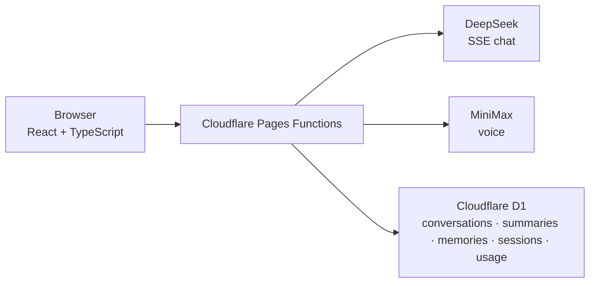

# Luna


[English](README.md) | [简体中文](README.zh-CN.md)

[](https://github.com/Xiaotian69/luna-ai-companion/actions/workflows/ci.yml)


[](LICENSE)

Luna is a self-hostable, single-user Chinese AI companion. It combines streaming conversation, inspectable long-term memory, and configurable voice in a focused web interface built for one private space.

## A companion with memory—and boundaries

Luna remembers useful context without turning memory into a black box. Conversations, summaries, and extracted long-term memories live in your D1 database; the memory screen lets you edit, disable, delete, or clear what was saved.

Her persona is explicit about being AI. The system prompt avoids invented human experiences, emotional dependency, exclusivity, and manipulative reassurance. This is still a cloud-backed application: chat content is processed by DeepSeek, and text is sent to MiniMax when voice generation is requested.

## Highlights

- **Conversation that flows:** DeepSeek responses arrive over SSE, with stop, regenerate, copy, delete, persistent history, and multiple conversations.
- **Transparent memory:** D1 stores conversation summaries and selected long-term memories; active memories are ranked into relevant context and remain user-manageable.
- **Natural voice, under your control:** MiniMax system voices, speed, pitch, volume, manual playback, optional auto-read, and browser-side audio caching.
- **Single-user access:** Password login, HMAC-signed secure cookies, hashed D1 session identifiers, and server-only provider credentials.
- **Cost guardrails:** Per-minute chat/TTS limits, daily call and estimated-token caps, plus a visible daily usage page.
- **Responsive by default:** Light and dark themes, a compact desktop rail, mobile bottom navigation, and safe-area-aware layout.

## Screenshots

| Streaming chat | Transparent memory |
| --- | --- |
|  |  |

| Persona and voice | Mobile chat |
| --- | --- |
|  |  |

All screenshots come from the local Cloudflare Pages stack with synthetic D1 data. No paid chat or TTS request was made during capture.

## How it works



The browser talks only to same-origin Pages Functions. Functions assemble persona, relationship state, relevant memories, summary, and recent messages before calling DeepSeek; completed responses are persisted and can trigger summary or memory extraction. MiniMax voice is requested separately and cached in the browser by text and voice settings.

## Quick start

Requirements: Node.js 24+ and a Cloudflare account for Wrangler/D1.

```bash
git clone https://github.com/Xiaotian69/luna-ai-companion.git
cd luna-ai-companion
npm ci
```

Copy `.dev.vars.example` to `.dev.vars`, replace every placeholder, then initialize the local D1 database and start the complete Pages stack:

```bash
npm run db:migrate:local
npm run dev:full
```

Open the Wrangler URL (normally `http://localhost:8788`) and sign in with `APP_PASSWORD`. `npm run dev` starts only Vite and expects a Pages Functions server at `http://localhost:8788` for API proxying.

### Deploy to Cloudflare Pages

1. Create the production database with `npx wrangler d1 create luna-db` and copy its `database_id` into `wrangler.toml`.
2. Apply migrations with `npx wrangler d1 migrations apply luna-db --remote`.
3. Create a Pages project connected to this repository. Use `npm run build` as the build command and `dist` as the output directory.
4. Bind the D1 database as `DB` and add `DEEPSEEK_API_KEY`, `MINIMAX_API_KEY`, `APP_PASSWORD`, and `SESSION_SECRET` as encrypted Pages secrets.
5. Deploy through the Pages Git integration. GitHub Actions validates the repository; it does not deploy or require provider keys.

## Configuration

| Variable / binding | Purpose |
| --- | --- |
| `DEEPSEEK_API_KEY` | Server-side DeepSeek credential |
| `MINIMAX_API_KEY` | Server-side MiniMax credential |
| `APP_PASSWORD` | Single-user login password; minimum 8 characters |
| `SESSION_SECRET` | HMAC signing secret; minimum 32 characters |
| `ENVIRONMENT` | `development`, `test`, or `production`; defaults to `development` |
| `DB` | Cloudflare D1 binding named exactly `DB` |

Behavior is intentionally centralized:

- `config/models.ts` — DeepSeek and MiniMax endpoints, model names, and generation defaults
- `config/limits.ts` — context thresholds, input limits, request rates, and daily quotas
- `config/persona.ts` — Luna's complete editable persona and relationship boundaries
- `migrations/0001_initial.sql` — D1 schema for conversations, messages, summaries, memories, relationship state, sessions, usage, and rate limits

The current configured defaults are DeepSeek `deepseek-v4-flash` and MiniMax `speech-2.8-turbo`.

## Security and cost controls

- Provider keys stay in Pages Functions. Never put them in `VITE_*` variables, which are bundled for the browser.
- Session cookies are `HttpOnly`, `Secure`, and `SameSite=Strict`; cookies are HMAC-signed, while only SHA-256 session identifiers are stored in D1.
- Default controls allow 12 chat requests/minute and 20 TTS requests/minute, with daily caps of 100 chat calls, 100 TTS calls, and 500,000 estimated chat tokens. Adjust them in `config/limits.ts` before deployment if needed.
- Auto-read is off by default. Identical text chunks with the same voice settings reuse the browser Cache API instead of generating audio again.
- DeepSeek receives chat context, and MiniMax receives text only when speech is requested. Review both providers' data policies for your deployment.
- Export D1 regularly, back up before high-risk changes, and rotate a provider key immediately if it was ever exposed.

## Quality checks

The CI workflow runs the same no-paid-API quality gate used locally:

```bash
npm run check:secrets
npm run typecheck
npm run lint
npm run test:run
npm run build
```

Run `npm run test:e2e` for the mocked desktop/mobile Playwright checks. Automated tests do not call paid model APIs.

## Roadmap

- **In development:** a local-first, hybrid provider architecture with configurable local and OpenAI-compatible endpoints. The supported implementation today remains Cloudflare Pages + D1 with DeepSeek chat and MiniMax voice.

## License

Released under the [MIT License](LICENSE). Copyright © 2026 Xiaotian69.
