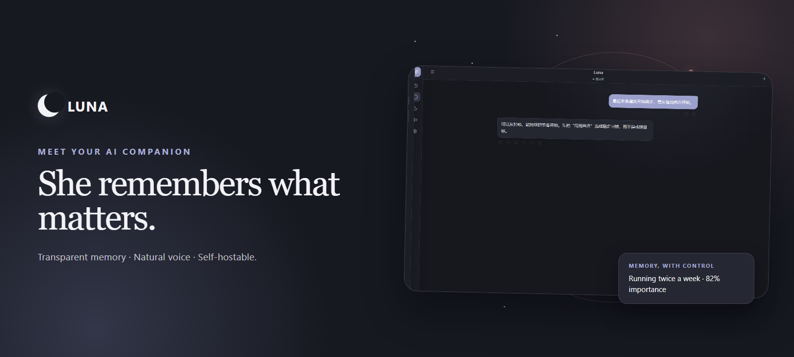
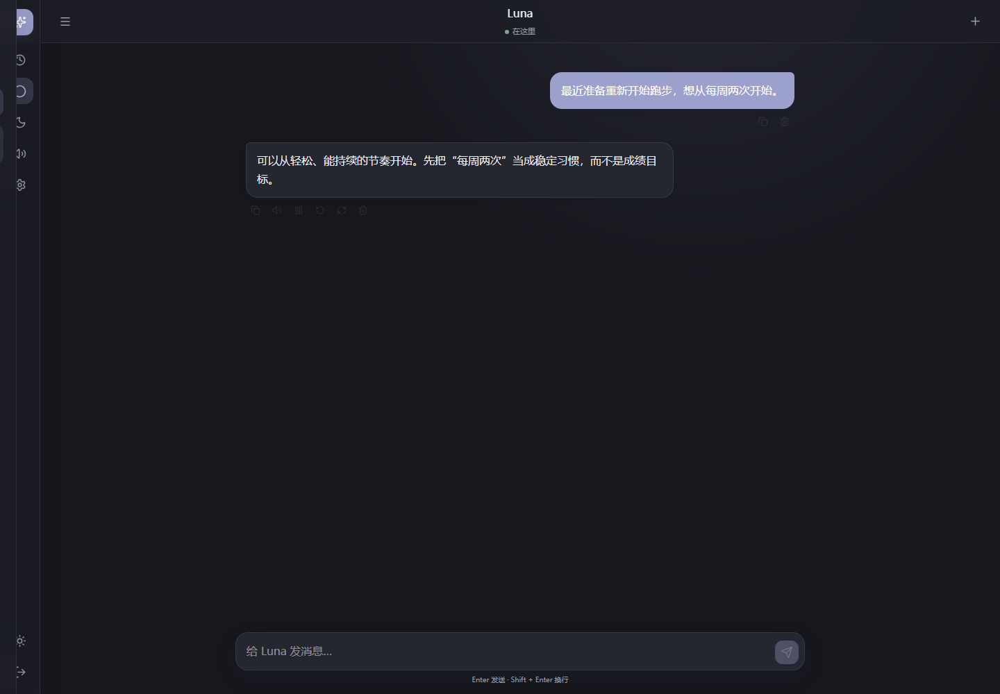
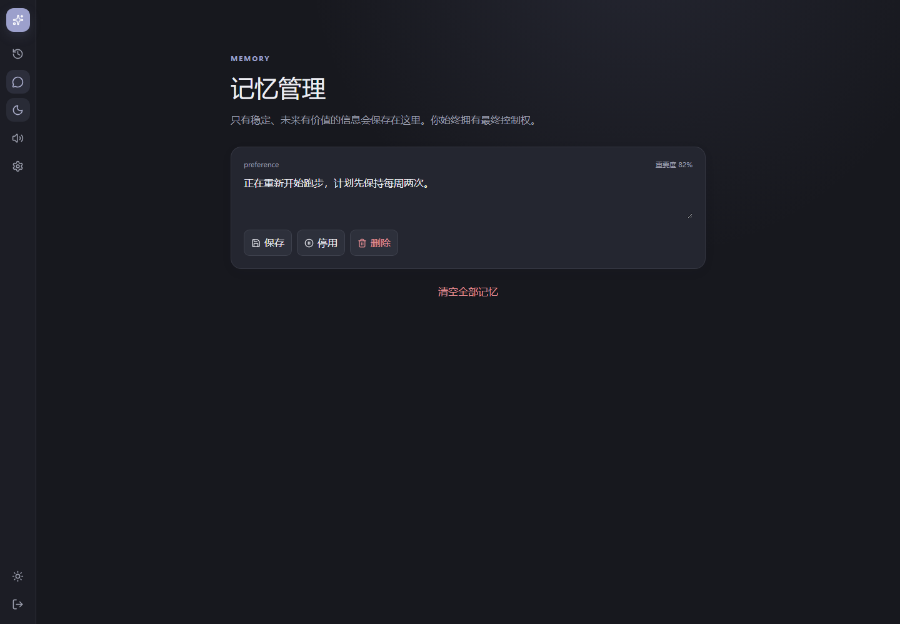
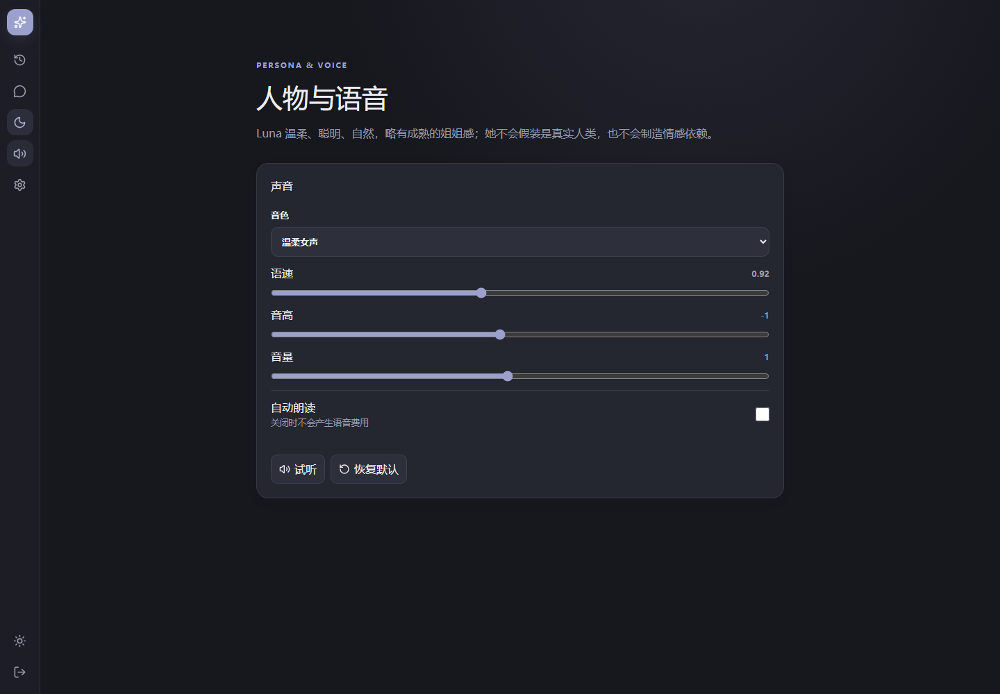
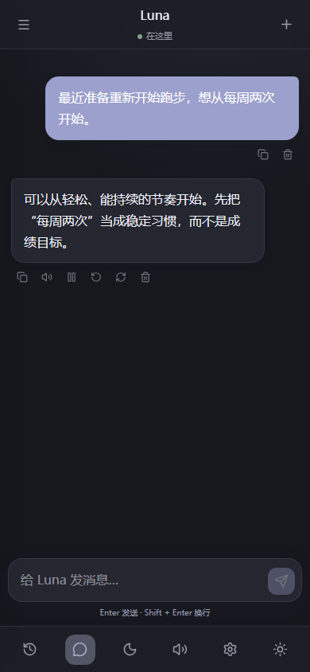
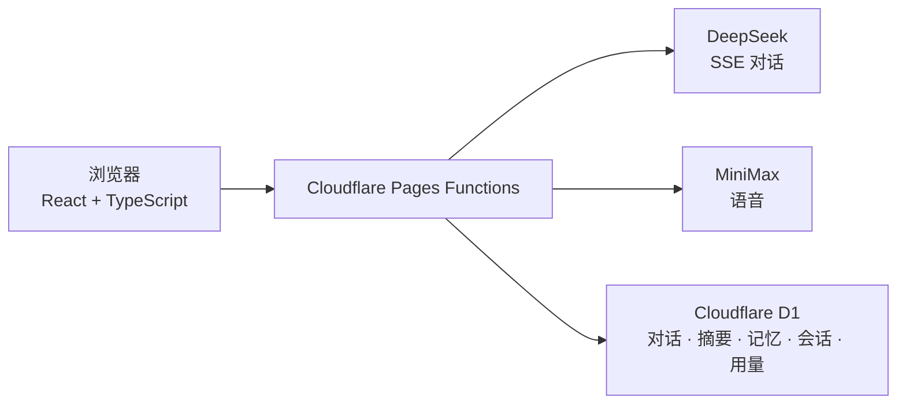

# Luna



[English](README.md) | [简体中文](README.zh-CN.md)

[](https://github.com/Xiaotian69/luna-ai-companion/actions/workflows/ci.yml)


[](LICENSE)

Luna 是一个可自行托管、面向单用户的中文 AI 陪伴应用。她把流式对话、可检查的长期记忆和可调节语音放进一个专注、私密的个人空间。

> **暂无公开在线演示。** Luna 面向部署在你自己 Cloudflare 账号下的单用户私有实例；模型密钥与登录密码只存放在 Cloudflare Secrets 或本地 `.dev.vars` 中，不会出现在本仓库。

## 有记忆，也有边界的陪伴

Luna 会记住有用的上下文，但不会把记忆藏进黑盒。对话、摘要和提取出的长期记忆保存在你的 D1 数据库中；你可以在记忆页面编辑、停用、删除或清空保存内容。

她的人物设定明确承认自己是 AI，不编造人类经历，也避免制造情感依赖、排他关系或操控式安慰。当前版本仍由云服务支撑：聊天内容会交给 DeepSeek 处理；只有在请求生成语音时，文本才会发送给 MiniMax。

## 功能亮点

- **自然连续的对话：** DeepSeek 通过 SSE 流式返回内容，支持停止、重新生成、复制、删除、历史持久化和多对话管理。
- **透明可控的记忆：** D1 保存对话摘要和筛选后的长期记忆；启用中的相关记忆会按相关性进入上下文，并始终可由用户管理。
- **由你控制的自然语音：** MiniMax 系统音色、语速、音高、音量、手动播放、可选自动朗读，以及浏览器端音频缓存。
- **单用户访问控制：** 密码登录、HMAC 签名安全 Cookie、D1 中的哈希会话标识，以及仅服务端可见的模型凭据。
- **费用护栏：** 聊天与 TTS 分钟级限流、每日调用与估算 Token 上限，并提供今日用量页面。
- **响应式体验：** 深浅主题、紧凑桌面图标栏、移动端底部导航和安全区适配。

## 界面截图

| 流式聊天 | 透明记忆 |
| --- | --- |
|  |  |

| 人物与语音 | 移动端聊天 |
| --- | --- |
|  |  |

所有截图均来自本地 Cloudflare Pages 完整栈与合成 D1 数据；截图过程中没有发送付费聊天或 TTS 请求。

## 工作原理



浏览器只访问同源 Pages Functions。Functions 会组合人物设定、关系状态、相关记忆、对话摘要与近期消息，再调用 DeepSeek；完整回复写入数据库后，可触发摘要或记忆提取。MiniMax 语音通过独立请求生成，并按文本和语音设置缓存在浏览器中。

## 快速开始

需要 Node.js 24+；Wrangler/D1 还需要 Cloudflare 账号。

```bash
git clone https://github.com/Xiaotian69/luna-ai-companion.git
cd luna-ai-companion
npm ci
```

将 `.dev.vars.example` 复制为 `.dev.vars`，替换全部占位值，然后初始化本地 D1 并启动完整 Pages 环境：

```bash
npm run db:migrate:local
npm run dev:full
```

打开 Wrangler 输出的地址（通常为 `http://localhost:8788`），使用 `APP_PASSWORD` 登录。`npm run dev` 只启动 Vite，并把 API 代理到预期运行在 `http://localhost:8788` 的 Pages Functions 服务。

### 部署到 Cloudflare Pages

1. 运行 `npx wrangler d1 create luna-db` 创建生产数据库，将返回的 `database_id` 写入 `wrangler.toml`。
2. 运行 `npx wrangler d1 migrations apply luna-db --remote` 应用远程迁移。
3. 创建连接本仓库的 Pages 项目，构建命令填写 `npm run build`，输出目录填写 `dist`。
4. 将 D1 数据库绑定为 `DB`，并把 `DEEPSEEK_API_KEY`、`MINIMAX_API_KEY`、`APP_PASSWORD`、`SESSION_SECRET` 添加为 Pages 加密 Secret。
5. 通过 Pages Git 集成部署。GitHub Actions 只验证仓库，不负责部署，也不需要模型 Key。

## 配置

| 变量 / 绑定 | 用途 |
| --- | --- |
| `DEEPSEEK_API_KEY` | 服务端 DeepSeek 凭据 |
| `MINIMAX_API_KEY` | 服务端 MiniMax 凭据 |
| `APP_PASSWORD` | 单用户登录密码，至少 8 位 |
| `SESSION_SECRET` | HMAC 签名密钥，至少 32 位 |
| `ENVIRONMENT` | `development`、`test` 或 `production`，默认为 `development` |
| `DB` | 名称必须为 `DB` 的 Cloudflare D1 绑定 |

主要行为集中在以下文件：

- `config/models.ts` — DeepSeek/MiniMax 接口、模型名称和生成默认值
- `config/limits.ts` — 上下文阈值、输入限制、请求速率和每日配额
- `config/persona.ts` — Luna 的完整可编辑人物设定与关系边界
- `migrations/0001_initial.sql` — 对话、消息、摘要、记忆、关系状态、会话、用量和限流所需的 D1 表结构

当前配置的默认模型是 DeepSeek `deepseek-v4-flash` 与 MiniMax `speech-2.8-turbo`。

## 安全与费用控制

- 模型 Key 只存在于 Pages Functions。不要写入 `VITE_*` 变量，因为这类变量会进入浏览器产物。
- 会话 Cookie 使用 `HttpOnly`、`Secure` 和 `SameSite=Strict`；Cookie 由 HMAC 签名，D1 只保存 SHA-256 会话标识。
- 默认允许每分钟 12 次聊天、20 次 TTS；每日上限为 100 次聊天、100 次 TTS 和 500,000 估算聊天 Token。如需调整，请在部署前修改 `config/limits.ts`。
- 自动朗读默认关闭。相同文本片段与相同语音设置会复用浏览器 Cache API 中的音频，不重复生成。
- DeepSeek 会收到聊天上下文；MiniMax 只在请求语音时收到待朗读文本。请结合自己的部署场景审阅两家服务商的数据政策。
- 定期导出 D1，在高风险变更前备份；若模型 Key 曾暴露，应立即轮换。

## 质量检查

CI 与本地使用同一组不依赖真实模型调用的质量门：

```bash
npm run check:secrets
npm run typecheck
npm run lint
npm run test:run
npm run build
```

运行 `npm run test:e2e` 可执行使用模拟接口的桌面端与移动端 Playwright 检查。自动化测试不会调用付费模型 API。

## 路线图

- **开发中：** 本地优先的混合提供商架构，支持可配置的本地与 OpenAI 兼容端点。当前受支持实现仍是 Cloudflare Pages + D1、DeepSeek 对话与 MiniMax 语音。

## 许可证

本项目采用 [MIT License](LICENSE)。Copyright © 2026 Xiaotian69。
