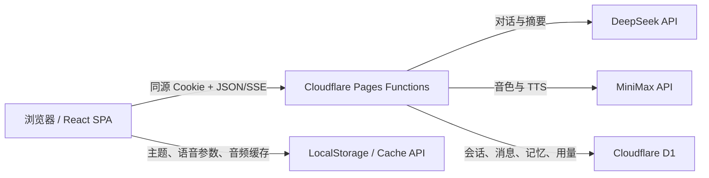

# Luna 项目对接文档

> 用途：帮助后续开发、部署或维护人员快速理解 Luna 已经完成了什么、如何运行、接口如何调用，以及哪些事项尚未完成。

## 1. 项目概况

| 项目 | 当前信息 |
| --- | --- |
| 项目名称 | Luna |
| 产品形态 | 单用户中文 AI 陪伴聊天网页 |
| 当前项目目录 | `E:\Grace` |
| 当前分支 / 提交 | `main` / `0548a45` |
| 本地访问地址 | `http://127.0.0.1:8788` |
| 前端 | React 19、Vite 8、TypeScript 6、Tailwind CSS 4 |
| 服务端 | Cloudflare Pages Functions |
| 数据库 | Cloudflare D1；本地状态位于 `.wrangler/state` |
| 文字模型 | DeepSeek `deepseek-v4-flash` |
| 语音模型 | MiniMax `speech-2.8-turbo` |
| 当前状态 | 本地功能已完成并验证；尚未部署到公网 Cloudflare Pages |

Luna 采用用户选择的 B 方案：桌面端使用极简图标栏，历史对话放在抽屉中；移动端使用底部安全区布局。界面包含浅色/深色主题，并针对手机尺寸做了响应式处理。

## 2. 已经完成的内容

### 2.1 聊天能力

- DeepSeek SSE 流式回复，文字逐段显示。
- 支持停止生成、重新生成最后一条回复。
- 支持新建对话、查看历史对话、删除对话。
- 支持复制、朗读和删除单条消息。
- 对话、消息和中断状态保存到 D1，刷新页面后仍可恢复。
- 新对话标题自动取首条消息的前 32 个字符。
- 单条用户输入最多 4,000 字符。

### 2.2 上下文、摘要与长期记忆

- 每次请求按照固定顺序组装上下文：

  1. Luna 人物设定。
  2. 当前关系状态。
  3. 与当前话题相关的启用记忆，最多 8 条。
  4. 当前对话的历史摘要。
  5. 最近 24 条消息。
  6. 本次用户输入。

- 当未压缩消息的估算 Token 超过 12,000，且可压缩消息不少于 12 条时，后台调用 DeepSeek 生成结构化摘要。
- 摘要保留：发生的事、用户想法与情绪、Luna 已有回应、尚未解决、后续必须记住、不应反复提起。
- 每次成功回复后，后台判断本轮是否包含稳定且未来有价值的长期记忆。
- 自动过滤猜测、临时琐事、密码、验证码、银行卡号、身份证等不必要敏感信息。
- 记忆内容去重；用户可以编辑、停用、启用、删除或全部清空。

### 2.3 人物设定

Luna 被设定为明确知道自己是 AI 的中文陪伴型对话伙伴。主要原则包括：

- 温柔、聪明、自然，略有成熟的姐姐感。
- 不假装是真实人类，不编造现实身体、经历或行动。
- 避免客服腔、机械夸奖、过度安慰和连续追问。
- 不使用吃醋、冷落、离开威胁或排他承诺制造情感依赖。
- 只引用上下文或记忆中实际存在的事实，不把推测当事实。

完整设定在 `config/persona.ts`。

### 2.4 MiniMax 语音

- 动态读取 MiniMax 系统音色，并优先排序普通话女性音色。
- 默认音色：`Chinese (Mandarin)_Warm_Bestie`。
- 可调节语速、音高和音量。
- 支持手动朗读、暂停、重播和自动朗读。
- 自动朗读关闭时，不会自动产生 TTS 调用费用。
- 长文本会拆分为最多 1,500 字符的片段后依次合成。
- 相同文本和相同参数使用浏览器 Cache API 缓存，减少重复费用。
- 同一时间只维护一个音频播放器，切换消息时会停止前一个音频。

2026-07-16 已用当前本地 MiniMax 凭据做真实验证：音色接口返回 303 个音色，短句 TTS 返回 HTTP 200，并生成 20,724 字节的 `audio/mpeg` 音频。API Key 不记录在本文档中。

### 2.5 单用户登录与安全

- 使用一个服务端环境变量 `APP_PASSWORD` 作为单用户登录密码。
- 密码比较使用固定时间比较，降低时序侧信道风险。
- 登录成功后生成 32 字节随机会话 ID，并使用 HMAC-SHA256 签名。
- D1 中只保存会话 ID 的 SHA-256 哈希，不保存原始 Cookie。
- 会话有效期为 7 天。
- Cookie 属性：`HttpOnly; Secure; SameSite=Strict`。
- 除 `/api/auth/login` 外，所有 `/api/*` 请求都必须通过会话验证。
- 所有模型 Key 只存在于 Pages Functions 服务端环境，不进入浏览器构建产物。
- 返回统一安全响应头：CSP、`X-Content-Type-Options`、`Referrer-Policy`、`Permissions-Policy` 和请求 ID。
- 使用 Zod 对 JSON 请求进行服务端校验。
- 已提供仓库密钥扫描脚本，防止常见 `sk-*` Key 被提交。

## 3. 系统架构



重要边界：浏览器永远不直接调用 DeepSeek 或 MiniMax。前端只调用同源 `/api/*`，由 Pages Functions 读取服务端 Secret 后访问模型供应商。

## 4. 主要目录说明

| 路径 | 作用 |
| --- | --- |
| `src/` | React 前端页面、组件、SSE 客户端和音频控制器 |
| `functions/api/` | Cloudflare Pages Functions API 路由 |
| `functions/_lib/clients/` | DeepSeek 与 MiniMax 客户端 |
| `functions/_lib/repositories/` | 所有 D1 SQL 数据访问层 |
| `functions/_lib/services/` | 鉴权、上下文、摘要、记忆、限额等业务逻辑 |
| `config/models.ts` | 模型、接口地址和主要模型参数 |
| `config/limits.ts` | 输入、上下文、限流和每日配额 |
| `config/persona.ts` | Luna 完整人物提示词 |
| `shared/` | 前后端共享 Schema、类型和流解析逻辑 |
| `migrations/0001_initial.sql` | D1 初始数据库结构 |
| `tests/`、`*.test.ts(x)` | 单元测试、集成测试和 D1 仓储测试 |
| `e2e/` | Playwright 桌面端和移动端测试 |
| `.github/workflows/ci.yml` | GitHub Actions 静态检查、测试和构建 |

## 5. 模型对接配置

### 5.1 DeepSeek

配置文件：`config/models.ts`

| 参数 | 当前值 |
| --- | --- |
| Base URL | `https://api.deepseek.com` |
| Endpoint | `/chat/completions` |
| Model | `deepseek-v4-flash` |
| Temperature | `0.85` |
| 最大输出 Token | `2048` |
| Stream | `true` |

聊天路由会把 DeepSeek 的 SSE 数据转换为 Luna 自己的 SSE 事件。回复完成后，摘要和记忆提取通过 Cloudflare `waitUntil` 在后台执行，不阻塞前端收到完成事件。

### 5.2 MiniMax

配置文件：`config/models.ts`

| 参数 | 当前值 |
| --- | --- |
| Base URL | `https://api.minimaxi.com` |
| 音色接口 | `/v1/get_voice` |
| TTS 接口 | `/v1/t2a_v2` |
| Model | `speech-2.8-turbo` |
| 默认语速 / 音高 / 音量 | `0.92` / `-1` / `1` |
| 情绪 | `calm` |
| 音频格式 | MP3、32 kHz、128 kbps、单声道 |

MiniMax 业务错误码 `2056` 会被转换为 HTTP 402 和 `TTS_UPSTREAM_QUOTA`，便于前端区分额度不足与普通上游故障。

## 6. API 对接说明

### 6.1 通用约定

- API Base：同源 `/api`。
- 除登录外，所有接口都需要 `luna_session` Cookie。
- JSON 请求必须设置 `Content-Type: application/json`。
- 普通成功响应使用 JSON；TTS 成功响应使用 `audio/mpeg`；聊天使用 `text/event-stream`。
- 普通错误格式：

```json
{
  "error": {
    "code": "ERROR_CODE",
    "message": "面向用户的中文说明"
  }
}
```

### 6.2 接口列表

| 方法 | 路径 | 作用 | 主要请求 / 响应 |
| --- | --- | --- | --- |
| `POST` | `/api/auth/login` | 登录 | 请求 `{ "password": "..." }`；成功设置 Cookie |
| `GET` | `/api/auth/session` | 检查登录态 | `{ "authenticated": true }` |
| `POST` | `/api/auth/logout` | 注销 | 删除 D1 会话并清空 Cookie |
| `GET` | `/api/conversations` | 对话列表 | `{ "conversations": [...] }` |
| `POST` | `/api/conversations` | 手动创建对话 | 请求 `{ "title": "新对话" }` |
| `GET` | `/api/conversations/:id` | 对话详情 | 返回 `{ "conversation": {...}, "messages": [...] }` |
| `DELETE` | `/api/conversations/:id` | 删除对话 | 级联删除消息和摘要 |
| `DELETE` | `/api/conversations/:id/messages/:messageId` | 删除单条消息 | `{ "ok": true }` |
| `POST` | `/api/chat` | 流式聊天 | 请求见下方；返回 SSE |
| `GET` | `/api/memories` | 读取全部记忆 | `{ "memories": [...] }` |
| `POST` | `/api/memories` | 手动新增记忆 | `memoryType`、`content`、`importance` |
| `PUT` | `/api/memories/:id` | 更新或启停记忆 | `content`、`importance`、`isActive` |
| `DELETE` | `/api/memories/:id` | 删除记忆 | `{ "ok": true }` |
| `POST` | `/api/memories/clear` | 清空全部记忆 | `{ "ok": true }` |
| `GET` | `/api/voices` | 获取并排序 MiniMax 音色 | `{ "voices": [...] }` |
| `POST` | `/api/tts` | 合成语音 | 请求文本和音色参数；返回 MP3 |
| `GET` | `/api/usage` | 查询当日用量与限制 | 用量按 UTC 日期统计 |

### 6.3 流式聊天

请求示例：

```json
{
  "conversationId": "可选；不传则自动创建",
  "content": "今天发生了一件事……",
  "regenerate": false
}
```

SSE 事件：

| 事件 | 数据 | 含义 |
| --- | --- | --- |
| `meta` | `conversationId`、`userMessageId` | 对话和用户消息已建立 |
| `delta` | `content` | 一段新增回复文本 |
| `done` | `messageId` | 完整回复已保存 |
| `error` | `code`、`message` | 中断或上游错误 |

当客户端停止请求时，已生成的部分内容会以 `interrupted` 状态保存；重新生成会复用最后一条用户消息，并替换此前最后一条助手回复。

### 6.4 TTS 请求

```json
{
  "text": "晚上好。",
  "voiceId": "Chinese (Mandarin)_Warm_Bestie",
  "speed": 0.92,
  "pitch": -1,
  "volume": 1
}
```

参数限制：文本 1–1,500 字符；语速 0.5–2；音高为 -12–12 的整数；音量 0.1–10。

## 7. D1 数据结构

| 表 | 作用 |
| --- | --- |
| `conversations` | 对话标题、创建时间和更新时间 |
| `messages` | 用户/助手/系统消息、Token 估算和完成状态 |
| `conversation_summaries` | 每个对话一份增量摘要及覆盖位置 |
| `memories` | 长期记忆、重要度、来源和启用状态 |
| `relationship_state` | 单例关系熟悉度、Luna 情绪和近期事件 |
| `sessions` | 会话 ID 哈希和过期时间 |
| `usage_daily` | 每日聊天、TTS 和估算 Token 用量 |
| `rate_limits` | 按时间窗口保存限流计数 |

删除对话时消息和摘要级联删除；记忆保留，但其来源对话/消息会被设为 `NULL`。

## 8. 当前限制与配额

配置文件：`config/limits.ts`

| 限制 | 当前值 |
| --- | --- |
| 单条输入 | 4,000 字符 |
| 最近上下文 | 24 条消息 |
| 相关长期记忆 | 8 条 |
| 摘要触发阈值 | 估算 12,000 Token |
| 登录尝试 | 10 次 / 10 分钟 |
| 聊天速率 | 12 次 / 分钟 / IP |
| TTS 速率 | 20 次 / 分钟 / IP |
| 每日聊天 | 100 次 |
| 每日 TTS | 100 次 |
| 每日估算 Token | 500,000 |

当前代码中的每日限额来自 `config/limits.ts`。`shared/env.ts` 虽然声明了 `DAILY_CHAT_LIMIT`、`DAILY_TTS_LIMIT` 和 `DAILY_TOKEN_LIMIT` 环境变量，但当前 `UsageGuard` 尚未读取这些覆盖值；如需线上动态配置，需要再补一层环境变量注入。

## 9. 本地环境变量

在项目根目录创建 `.dev.vars`：

```dotenv
DEEPSEEK_API_KEY=你的服务端密钥
MINIMAX_API_KEY=你的服务端密钥
APP_PASSWORD=至少8位的登录密码
SESSION_SECRET=至少32位随机字符串
ENVIRONMENT=development
```

安全要求：

- 不要把真实值写进 `README.md`、本文档、Git 提交或 `VITE_*` 环境变量。
- `.dev.vars` 已被 `.gitignore` 排除。
- 如果 Key 曾出现在公开位置或 Git 历史中，应立即到供应商控制台轮换。

## 10. 本地运行

环境要求：Node.js 24+。

```bash
cd /d E:\Grace
npm ci
npm run db:migrate:local
npm run dev:full
```

然后打开 `http://127.0.0.1:8788`，使用 `.dev.vars` 中的 `APP_PASSWORD` 登录。

常用命令：

```bash
npm run dev             # 仅启动 Vite 前端
npm run dev:full        # 构建并启动 Pages 静态资源、Functions 与本地 D1
npm run db:migrate:local
npm run check:secrets
npm run typecheck
npm run lint
npm run test:run
npm run build
npm run test:e2e
```

## 11. Cloudflare 部署步骤

线上部署目前尚未执行。接手人需要完成：

1. 为仓库添加 GitHub 远程地址并推送 `main`；当前本地仓库没有配置 remote。
2. 执行 `npx wrangler login`。
3. 执行 `npx wrangler d1 create luna-db`。
4. 用返回的真实 `database_id` 替换 `wrangler.toml` 中的全零占位值。
5. 执行 `npx wrangler d1 migrations apply luna-db --remote`。
6. 在 Cloudflare Pages 创建项目，构建命令设置为 `npm run build`，输出目录设置为 `dist`。
7. 为 Pages 绑定 D1，变量名必须是 `DB`。
8. 在 Pages 的 Secrets 中设置：
   - `DEEPSEEK_API_KEY`
   - `MINIMAX_API_KEY`
   - `APP_PASSWORD`
   - `SESSION_SECRET`
9. 不要创建 `VITE_DEEPSEEK_*` 或 `VITE_MINIMAX_*` 变量。
10. 首次上线后验证登录、聊天流、音色列表、TTS、记忆和用量页面。

## 12. 测试与质量保障

项目包含：

- Vitest 单元与组件测试。
- Miniflare D1 仓储集成测试。
- DeepSeek CRLF SSE 解析回归测试。
- Cloudflare 全局 `fetch` 绑定回归测试。
- MiniMax 业务错误码保留测试。
- Playwright 桌面端与移动端响应式测试。
- TypeScript 严格类型检查。
- ESLint。
- Git 仓库密钥扫描。
- GitHub Actions 自动运行静态检查、测试和构建。

最近一次完整验证基线：18 个测试文件、37 项测试全部通过；Playwright 3 项通过，1 项桌面环境下按设计跳过；生产构建成功。

## 13. 已知事项与后续建议

### 必须在公网部署前完成

- 替换 `wrangler.toml` 的 D1 `database_id` 占位值。
- 配置 GitHub remote、Cloudflare Pages、D1 Binding 和线上 Secrets。
- 选择正式域名，并确认 HTTPS 下 Cookie 和 CSP 行为。
- 备份本地 D1 后再切换生产数据库，避免误以为本地聊天记录会自动上传。

### 可以后续增强

- 让每日配额真正支持环境变量覆盖。
- 增加对话重命名与记忆手动新增的前端入口。
- 增加 D1 导出、恢复和定期备份脚本。
- 增加线上可观测性、匿名错误统计和上游响应耗时指标。
- 为模型不可用、余额不足和网络断开提供更细的前端错误状态。
- 部署后加入 Cloudflare 环境的端到端冒烟测试。

## 14. 交接检查清单

- [ ] 能打开 `E:\Grace` 并看到 `main` 分支。
- [ ] `.dev.vars` 存在，且没有被 Git 跟踪。
- [ ] `npm ci`、`npm run test:run`、`npm run build` 可成功执行。
- [ ] `npm run dev:full` 后可在 `http://127.0.0.1:8788` 登录。
- [ ] 可以发送流式消息、停止生成并查看历史记录。
- [ ] 记忆管理页可以编辑、停用和删除记忆。
- [ ] 语音设置页能读取音色并生成试听音频。
- [ ] 公网部署前已替换 D1 ID，并把 Secret 配置在 Cloudflare 服务端。

---

对接时优先查看的文件：`README.md`、`config/models.ts`、`config/limits.ts`、`config/persona.ts`、`migrations/0001_initial.sql`、`functions/_middleware.ts` 和 `functions/api/chat.ts`。
