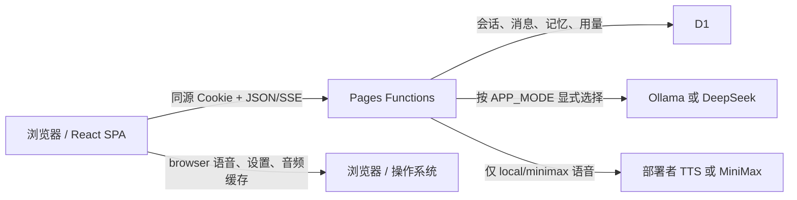

# Luna 项目对接文档

> 面向开发、部署和维护人员。代码与共享 Schema 是最终契约；本文不记录机器相关绝对路径、分支或易过期提交号。

## 1. 运行形态

Luna 是单用户、中文优先的 React 19 + Vite 8 前端，服务端为 Cloudflare Pages Functions，持久化使用 D1。本地 Wrangler 状态位于 `.wrangler/state`。

文本提供方：

- `APP_MODE=local`、`CHAT_PROVIDER=ollama`：本机 Ollama OpenAI 兼容 API，默认 `http://127.0.0.1:11434/v1` / `qwen3:4b`。
- `APP_MODE=cloud`、`CHAT_PROVIDER=deepseek`：默认 `https://api.deepseek.com` / `deepseek-v4-flash`，需要 `DEEPSEEK_API_KEY` 或通用 `CHAT_API_KEY`。
- 本地失败不静默回退。聊天请求只有同时提交 `providerOverride: "cloud"` 与 `confirmCloudOverride: true` 才可能显式覆盖，且服务端仍必须存在可用云配置。

语音提供方保存在浏览器设置中：`browser`（默认）、`local`、`minimax`。浏览器语音不调用 Luna 的 TTS API；后两者需要部署者分别配置 `LOCAL_TTS_ENDPOINT` / `MINIMAX_API_KEY`。

## 2. 架构与隐私流



服务端 Key 不得进入浏览器构建。模型只收到本轮组装上下文；召回 metadata 只列出真正注入的有限记忆。完整威胁模型见 [SECURITY.md](./SECURITY.md)。

## 3. 主要目录

| 路径 | 作用 |
| --- | --- |
| `src/` | React 页面、聊天/SSE、记忆、语音与设置 |
| `functions/api/` | 鉴权后的 Pages Functions 路由 |
| `functions/_lib/clients/` | 聊天与 MiniMax 客户端 |
| `functions/_lib/repositories/` | D1 数据访问与并发约束 |
| `functions/_lib/services/` | 上下文、摘要、记忆提取/召回、限额 |
| `shared/` | 前后端共享 Zod Schema、SSE 与备份格式 |
| `migrations/` | `0001` 基础表至 `0005` 记忆召回索引 |
| `config/` | 模型默认值、限额、人格基线 |
| `scripts/` | 本地运行预检与当前/历史密钥扫描 |

## 4. 上下文与记忆

每轮按固定结构组装：基础安全人格 + 可编辑伴侣档案、关系状态、最多 8 条实际召回记忆、对话摘要、最近 24 条消息、本轮输入。未压缩历史估算超过 12,000 token 且可压缩消息至少 12 条时生成结构化摘要。

记忆字段包括 `memoryType`、`content`、`importance`、`category`、`sensitivity`、`confidence`、`accessCount`、`lastAccessedAt`、`supersededMemoryId` 和启用状态。自动提取会阻止凭据、身份、支付、健康与亲密内容。服务层虽接受仅由可信调用方提供的 `confirmedSensitive`，但当前聊天 API 和界面没有暴露确认参数，因此这些敏感类别当前不会从聊天自动写入。记忆管理界面可编辑、启停和删除已有记忆；`POST /api/memories` 可手动新增普通长期记忆。规范化内容、唯一索引和条件更新共同处理重复、强化和冲突替换。

召回先限制候选，再按关键词/分类、待续状态、重要度、时效和访问情况确定性排序，ID 负责稳定平局。若同时配置 `EMBEDDING_BASE_URL` 和 `EMBEDDING_MODEL`，会调用仅回环的 OpenAI 兼容 `/embeddings`；失败或未配置时始终使用确定性回退。

`meta.usedMemories` 仅包含真正传给聊天提供方的 `{ id, displayText }`；展示文本会去控制字符、折叠空白并截断。写入模型的完整内容不在这个 metadata 中重复公开。

## 5. API 契约

所有 API 同源位于 `/api`。除 `POST /api/auth/login` 外都需要 `luna_session` Cookie。普通错误形如：

```json
{ "error": { "code": "ERROR_CODE", "message": "面向用户的中文说明" } }
```

| 方法 | 路径 | 说明 |
| --- | --- | --- |
| `POST` | `/api/auth/login` | `{ "password": "..." }`，成功设置 Cookie |
| `GET` / `POST` | `/api/auth/session` / `/api/auth/logout` | 检查会话 / 注销 |
| `GET` / `PUT` | `/api/companion` | 获取 / 更新伴侣档案 |
| `GET` | `/api/runtime` | `{ mode, provider, model, configured, reachable }`，不返回 URL/Key |
| `GET` / `POST` | `/api/conversations` | 列表 / 新建 |
| `GET` / `DELETE` | `/api/conversations/:id` | 详情 / 删除 |
| `DELETE` | `/api/conversations/:id/messages/:messageId` | 删除消息 |
| `POST` | `/api/chat` | SSE 流式聊天 |
| `GET` / `POST` | `/api/memories` | 列表 / 手动新增 |
| `PUT` / `DELETE` | `/api/memories/:id` | 编辑启停 / 删除 |
| `POST` | `/api/memories/clear` | 清空记忆 |
| `GET` | `/api/memories/export` | 下载 schema v1 JSON 备份 |
| `POST` | `/api/memories/import` | 确认后恢复备份 |
| `GET` | `/api/voices?provider=browser\|local\|minimax` | 提供方配置状态与音色 |
| `POST` | `/api/tts` | `local` 或 `minimax` 合成音频 |
| `GET` | `/api/usage` | 当日 UTC 用量 |

### 聊天请求与 SSE

```json
{
  "conversationId": "可选",
  "content": "今天发生了一件事……",
  "regenerate": false
}
```

`content` 最长 4,000 字符。显式云覆盖时另加 `providerOverride: "cloud"` 与 `confirmCloudOverride: true`。SSE：

| 事件 | 数据 |
| --- | --- |
| `meta` | `conversationId`、`userMessageId`、`usedMemories[]` |
| `delta` | `content` 增量 |
| `done` | 已保存的 `messageId` |
| `error` | 稳定 `code` 与用户消息 |

客户端中止后，已有片段按 `interrupted` 保存。重新生成复用最后一条用户消息。

### 伴侣档案

`PUT /api/companion` 字段为 `displayName`、`avatarUrl`、`relationshipPreset`（`girlfriend|boyfriend|friend|custom`）、`customRelationship`、`userAddress`、`personality`、`speakingStyle`、`boundaries`。自定义关系必须填写名称。

### 语音请求

```json
{
  "provider": "local",
  "text": "晚上好。",
  "voiceId": "default",
  "speed": 0.92,
  "pitch": -1,
  "volume": 1
}
```

`provider` 只能为 `local` 或 `minimax`；`browser` 不发服务端请求。文本 1–1,500 字符，速度 0.5–2，音高 -12–12 整数，音量 0.1–10。

### 记忆备份

导出文档 `schemaVersion` 当前为 `1`，最多 1,000 条。导入为 `{ "confirmation": true, "backup": { ... } }`，整个 JSON 请求上限 2 MiB。整份文档严格校验后才开始分批、重复安全地写入；它不是跨全部条目的单一 D1 事务。

## 6. 环境变量

权威定义分别在 `shared/env.ts`、`functions/_lib/types.ts`、`.dev.vars.example` 和 `.dev.vars.local.example`。

| 变量 | 规则 |
| --- | --- |
| `APP_PASSWORD` | 必需，至少 8 字符 |
| `SESSION_SECRET` | 必需，至少 32 字符 |
| `APP_MODE` | `local|cloud`，默认 `cloud` |
| `CHAT_PROVIDER` | `ollama|deepseek`，默认 `deepseek` |
| `CHAT_BASE_URL` | 可选 HTTP(S)，禁止凭据、query、fragment |
| `CHAT_MODEL` | 可选非空模型名 |
| `CHAT_API_KEY` / `DEEPSEEK_API_KEY` | 当前 DeepSeek 云 provider 至少一项可用；`CHAT_API_KEY` 是通用服务端替代字段，Ollama 不需要 |
| `EMBEDDING_BASE_URL` + `EMBEDDING_MODEL` | 可选且需成对；客户端仅允许回环端点 |
| `MINIMAX_API_KEY` | 可选云语音 |
| `LOCAL_TTS_ENDPOINT` | 可选；本地只回环，云端只外部 HTTPS 公共 FQDN |
| `ENVIRONMENT` | `development|test|production` |

`DAILY_CHAT_LIMIT`、`DAILY_TTS_LIMIT`、`DAILY_TOKEN_LIMIT` 在通用环境 Schema 中有默认值，但当前 Pages `Bindings` 和 `UsageGuard` 仍使用 `config/limits.ts` 的固定值；不要宣称部署变量已能覆盖它们。

## 7. 本地开发与部署

本地 Ollama 流程：

```powershell
npm ci
Copy-Item .dev.vars.local.example .dev.vars.local
npm run check:local
npm run db:migrate:local
npm run dev:local
```

云聊天开发使用 `.dev.vars.example` → `.dev.vars` 与 `npm run dev:cloud`。公网部署逐步说明见 [CLOUD_MODE.md](./CLOUD_MODE.md)，本地故障码见 [LOCAL_MODE.md](./LOCAL_MODE.md)。

质量门：

```powershell
npm run check:secrets
npm run typecheck
npm run lint
npm run test:run
npm run build
npm run test:e2e
```

测试不调用付费服务；真实 Ollama、DeepSeek、MiniMax、TTS 和 Cloudflare 部署需要另外的最小烟雾测试。

## 8. 交接检查

- `wrangler.toml` 的生产 `database_id` 已替换，Pages D1 binding 名为 `DB`。
- 本地 `.dev.vars*` 未被跟踪，Cloudflare Secrets 仅在服务端。
- 本地/云端模式和语音提供方与预期一致，没有静默回退。
- 能登录、自定义伴侣、流式聊天、看到实际使用记忆、导出并确认恢复备份。
- 已阅读 [SECURITY.md](./SECURITY.md)，尤其是备份、D1、日志、TTS 和 DNS 信任边界。
- 当前提交已通过 CI 同等命令；硬件/付费/公网路径另有烟雾测试记录。
